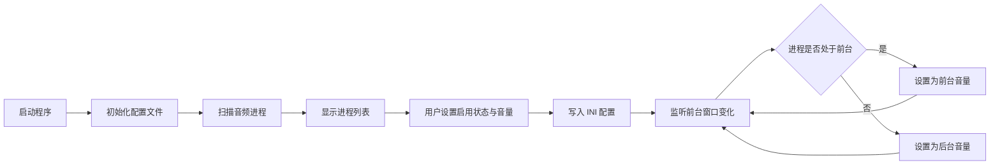
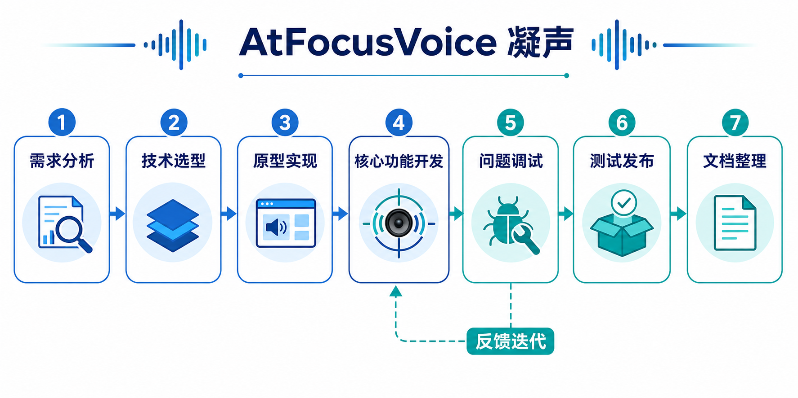

# AtFocusVoice 凝声软件工程开发文档

## 项目信息

| 项目 | 内容 |
| --- | --- |
| 项目名称 | AtFocusVoice 凝声 |
| 项目类型 | Windows 桌面应用程序 |
| 开发框架 | .NET 8 + WPF |
| 主要语言 | C# |
| 主要依赖 | NAudio |
| 配置方式 | INI 配置文件 |
| 运行平台 | Windows |

## 一、项目背景

在日常使用电脑时，用户经常会同时运行游戏、浏览器、聊天软件和音乐软件。问题在于，当用户切换到另一个窗口时，后台程序的声音仍然会继续播放，容易干扰当前任务。

Windows 自带音量混合器可以手动调整不同应用程序的音量，但它不能根据窗口是否处于前台自动调整音量。因此，本项目希望实现一个自动化工具：当某个被管理的应用程序处于前台时使用前台音量，当它切换到后台时自动调整为后台音量。

AtFocusVoice 的含义是“让声音跟随焦点”。中文名“凝声”表示将声音集中到当前关注的应用程序上。

## 二、需求分析

### 2.1 基础需求

- 显示当前存在音频会话的进程。
- 用户可以选择需要管理的进程。
- 程序能够检测当前前台窗口。
- 当前台窗口变化时，自动调整被管理进程的音量。
- 用户设置需要在程序重启后保留。

### 2.2 后续迭代需求

初版程序只能保存“是否启用”，启用后直接将后台音量设为 `0%`、前台音量设为 `100%`。这种设计过于简单，无法满足“后台保留较低音量”的实际需求。

因此后续加入了更细的配置：

- 每个进程可以单独设置前台音量。
- 每个进程可以单独设置后台音量。
- 配置文件中分别保存启用状态、前台音量和后台音量。
- 程序启动后默认隐藏到系统托盘。
- 左键点击托盘图标打开主界面。
- 右键点击托盘图标显示菜单，可选择打开主界面或退出。
- 限制程序只能运行一个实例，避免多个托盘图标和重复控制音量。

## 三、技术选型

### 3.1 为什么没有使用 Python

项目早期考虑过使用 Python，因为 Python 语法简单，开发速度较快。但对于普通 Windows 用户来说，Python 程序通常需要额外安装解释器和依赖库，发布和运行门槛较高。

本项目面向的是一个可直接运行的桌面工具，因此最终没有选择 Python。

### 3.2 选择 .NET 和 WPF 的原因

最终选择 .NET + WPF，主要原因如下：

- .NET 对 Windows 桌面程序支持较好。
- WPF 适合开发传统桌面 GUI。
- C# 可以方便调用 Windows API。
- 可以通过 `dotnet publish` 发布为自带运行时版本。
- 与 NAudio 等 Windows 音频库配合较方便。

### 3.3 使用 NAudio 的原因

Windows 的应用音量控制实际基于音频会话。NAudio 封装了 WASAPI 相关接口，可以获取默认音频设备、遍历音频会话，并根据进程 ID 调整对应应用程序的音量。

核心流程如下：

```csharp
var enumerator = new MMDeviceEnumerator();
var device = enumerator.GetDefaultAudioEndpoint(DataFlow.Render, Role.Multimedia);
var sessions = device.AudioSessionManager.Sessions;
```

程序遍历 `sessions`，当 `session.GetProcessID` 与目标进程 ID 相同时，修改 `session.SimpleAudioVolume.Volume`。

## 四、系统设计

### 4.1 总体流程



### 4.2 焦点监听设计

初期方案是定时轮询当前前台窗口，但轮询存在资源浪费和响应延迟问题。后续改为使用 Windows 的 `SetWinEventHook` 监听 `EVENT_SYSTEM_FOREGROUND` 事件。

```csharp
SetWinEventHook(
    EVENT_SYSTEM_FOREGROUND,
    EVENT_SYSTEM_FOREGROUND,
    IntPtr.Zero,
    _winEventDelegate,
    0,
    0,
    0);
```

这样当前台窗口变化时，系统会主动通知程序，程序再根据当前前台进程和用户配置调整音量。

### 4.3 配置文件设计

配置文件保存在：

```text
AppData\Roaming\AtFocusVoice\processConfig.ini
```

当前配置分为三类：

```ini
[Processes]
chrome=True
game=True

[ForegroundVolumes]
chrome=100
game=80

[BackgroundVolumes]
chrome=20
game=0
```

这种设计保留了旧版本的 `Processes=true/false` 配置，同时允许新版本扩展前台和后台音量。

### 4.4 托盘运行设计

程序启动后不直接显示主窗口，而是先创建后台监听逻辑和系统托盘图标。托盘交互规则如下：

- 左键点击托盘图标：打开主界面。
- 右键点击托盘图标：显示菜单。
- 菜单中包含“打开主界面”和“退出”。
- 点击窗口关闭按钮：隐藏窗口，不退出程序。
- 点击“退出”：释放托盘图标和焦点监听，真正结束程序。

## 五、开发过程

### 5.1 第一阶段：验证核心功能

第一阶段目标是确认“根据前台窗口调整指定进程音量”是否可行。开发者先完成了进程列表、音频会话枚举和简单的启用开关。

这一阶段的实现方式比较直接：

- 进程列表只显示有音频会话的进程。
- 启用后，前台音量固定为 `100%`。
- 后台音量固定为 `0%`。
- 用户设置保存为 `true/false`。

这个版本证明了技术路线可行，但功能粒度不足。

### 5.2 第二阶段：改进为前台/后台独立音量

在实际使用中，直接静音后台应用并不总是合理。例如用户可能希望后台游戏保留 `10%` 音量，或者希望浏览器切到后台后仍然保持 `30%` 音量。

因此后续将配置从单一布尔值扩展为：

- 是否启用。
- 前台音量。
- 后台音量。

界面中加入两个滑块，分别用于设置前台音量和后台音量。滑块变化时立即写入 INI 文件，并实时应用到对应进程。

### 5.3 第三阶段：隐藏到托盘

原版本要求窗口必须存在，最多只能最小化。对于一个后台工具来说，这不符合使用习惯。

因此加入托盘运行逻辑：

- 程序启动后默认驻留托盘。
- 主窗口只在用户需要配置时打开。
- 关闭窗口时只隐藏窗口。
- 托盘菜单提供真正退出入口。

这使程序更符合工具类软件的行为。

### 5.4 第四阶段：项目更名和发布整理

原项目名中曾把 `Focus` 拼写为 `Foucs`。在整理为期末作业项目时，对项目进行了完整更名：

- 解决方案文件改为 `AtFocusVoice.sln`。
- 项目文件改为 `AtFocusVoice.csproj`。
- 命名空间改为 `AtFocusVoice`。
- 程序输出名改为 `AtFocusVoice`。
- 配置目录改为 `AppData\Roaming\AtFocusVoice`。
- 文档和 README 同步修改。

这一步不是单纯重命名文件，而是对项目结构、命名空间、构建输出和用户配置路径进行统一。

## 六、开发中遇到的问题与解决

### 6.1 Restore 时间较长，误以为构建卡死

在重新整理项目时，执行：

```powershell
dotnet build
```

程序长时间停留在 Restore 阶段，容易误判为卡死。实际等待后发现构建可以成功，只是首次还原依赖耗时较长。

解决方式：

- 使用 `dotnet build AtFocusVoice.sln -v:minimal` 明确观察构建输出。
- 区分 Restore 阶段耗时和真正的构建失败。
- 后续 Restore 缓存存在后，构建速度明显变快。

### 6.2 发布时并行构建互相占用文件

在验证两个发布配置时，曾同时运行两个 `dotnet publish`：

```powershell
dotnet publish AtFocusVoice.csproj /p:PublishProfile=FolderProfile
dotnet publish AtFocusVoice.csproj /p:PublishProfile=FolderProfile1
```

结果出现 `App.g.cs`、`MainWindow.g.cs` 或 `AtFocusVoice.dll` 被另一个进程占用的问题。

原因是 WPF 项目在发布时会生成中间文件，两个发布进程同时写入同一个 `obj\Release` 目录，导致文件锁冲突。

解决方式：

- 不并行发布 WPF 项目。
- 两个发布配置必须串行执行。
- 第一个发布完成后，再执行第二个发布。

### 6.3 多次启动导致多个托盘图标

早期版本没有单实例限制，多次点击 exe 会启动多个程序实例。结果是：

- 托盘中出现多个图标。
- 多个实例同时监听前台窗口。
- 多个实例可能同时修改同一个应用程序音量。

解决方式是在程序启动时加入 `Mutex`：

```csharp
_singleInstanceMutex = new Mutex(true, @"Local\AtFocusVoice.SingleInstance", out bool createdNew);
if (!createdNew)
{
    Shutdown();
    return;
}
```

这样第二个实例启动后会立即退出，系统中只保留一个真正运行的 AtFocusVoice。

### 6.4 打开主界面时偶发 VisualTarget 异常

测试托盘功能时，曾出现：

```text
System.ArgumentException: VisualTarget 的根 Visual 不能具有父级。
```

该问题发生在从托盘点击打开主窗口时。结合当时已经启动多个实例的情况判断，窗口对象的显示状态可能被重复实例或异常窗口生命周期影响。

解决方式：

- 先用单实例机制避免多个程序同时运行。
- 在 `ShowMainWindow()` 中加入防御逻辑。
- 如果显示窗口时出现异常，则释放旧窗口后台资源并重新创建主窗口。

### 6.5 音量滑块显示过短

加入前台和后台音量滑块后，界面中滑块几乎只显示成一个小点。原因是 `GridView` 单元格没有自动拉伸内容，`Slider` 被压缩到最小宽度。

解决方式：

- 给 `ListViewItem` 设置 `HorizontalContentAlignment=Stretch`。
- 给音量列设置更合理的宽度。
- 使用 `Grid` 固定滑块区域和百分比文本区域。

### 6.6 配置从布尔值扩展为数值时的兼容问题

原配置只有：

```ini
[Processes]
chrome=True
```

如果直接废弃旧配置，会导致用户原来的启用状态丢失。因此新版本保留 `Processes` 段，只新增 `ForegroundVolumes` 和 `BackgroundVolumes`。

如果配置文件中没有音量值，程序使用默认值：

- 前台音量：`100`
- 后台音量：`0`

这样可以保证旧配置仍然可用。

## 七、测试与发布

### 7.1 构建测试

使用命令：

```powershell
dotnet build AtFocusVoice.sln -v:minimal
```

当前构建结果：

```text
0 个警告
0 个错误
```

### 7.2 多实例测试

测试方式：连续启动两次程序。

预期结果：系统中只保留一个 `AtFocusVoice.exe`。

测试结果：通过。第二个实例会自动退出。

### 7.3 发布测试

项目保留两种发布方式：

```powershell
dotnet publish AtFocusVoice.csproj /p:PublishProfile=FolderProfile
```

该配置发布自带运行时版本，适合未安装 .NET 运行时的电脑。

```powershell
dotnet publish AtFocusVoice.csproj /p:PublishProfile=FolderProfile1
```

该配置发布依赖运行时版本，适合已经安装 .NET 运行时的电脑。

注意：两个发布命令应当串行执行，不应同时运行。

## 八、AI 工具在开发中的作用

本项目中，AI 工具主要用于辅助查询和排查问题，例如：

- 理解 Windows 前台窗口事件监听方式。
- 辅助分析 NAudio 音频会话控制逻辑。
- 辅助定位 WPF 托盘窗口生命周期问题。
- 辅助整理 Markdown 开发文档。
- 辅助生成应用图标和流程图素材。

但项目的需求来源、功能取舍、测试反馈和最终验收仍由开发者完成。开发者需要判断哪些建议适合项目，哪些实现会引入新的问题。例如从“简单静音”改为“前台/后台音量”就是基于实际使用体验做出的需求调整。

## 九、项目成果

最终完成的 AtFocusVoice 具备以下功能：

- 自动识别具有音频会话的进程。
- 支持选择需要管理的进程。
- 支持为每个进程设置前台音量和后台音量。
- 支持监听窗口焦点变化并自动调整音量。
- 支持将配置保存到 INI 文件。
- 支持启动后隐藏到系统托盘。
- 支持托盘左键打开主界面。
- 支持托盘右键菜单打开主界面或退出。
- 支持单实例运行，避免多个托盘图标和重复控制。
- 支持发布为自带运行时版本和依赖运行时版本。

该项目虽然规模不大，但完整经历了需求分析、技术选型、原型开发、功能迭代、问题调试、构建发布和文档整理过程，符合软件工程课程对开发过程记录的要求。

## 十、工程开发流程图



也可以使用 Mermaid 版本：


